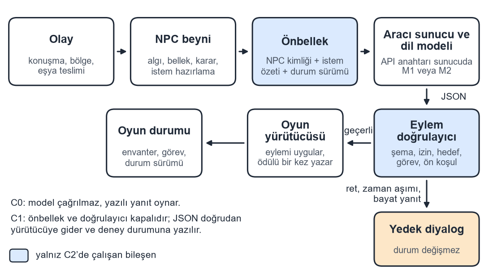
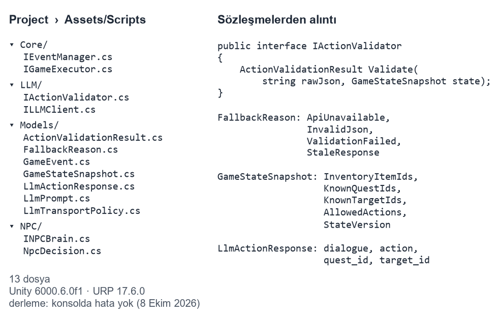

# TÜBİTAK 2209-A Araştırma Önerisi Formu (2026 Yılı, 1. Dönem)

## A. GENEL BİLGİLER

Başvuru Sahibinin Adı Soyadı: Muhammet Furkan Bilici

Araştırma Önerisinin Başlığı: Büyük Dil Modeli Destekli Oyuncu Olmayan Karakter (NPC) Eylemlerinin Oyun Kurallarına Göre Doğrulanması

Danışmanın Adı Soyadı: Arş. Gör. Dr. Hakan Aydın

Araştırmanın Yürütüleceği Kurum/Kuruluş: Karadeniz Teknik Üniversitesi

## ÖZET

Dijital oyunlarda oyuncu olmayan karakterlerin (NPC) cümleleri çoğunlukla önceden yazıldığı için oyuncunun beklenmedik tercihleri aynı hazır yanıtla karşılanır. Büyük dil modelleri bu sınırı yeni cümleler üreterek aşabilir; ancak üretilen cümle envanterde olmayan bir eşyayı varmış gibi gösterebilir, kapanmış bir görevi yeniden açabilir veya sahnede bulunmayan bir karaktere eylem yöneltebilir. Bu projede dil modeli karar veren değil öneri üreten bir bileşendir ve öneri oyun durumuna yazılmadan önce şema, izin ve ön koşul denetimi yapan bir doğrulama katmanından geçer. Şema ve izin denetimi yapısal hataları yakalar, fakat diyalogun envanterle çelişmesi gibi anlamsal tutarsızlıklar eylem alanı geçerli olduğu için bu denetimden geçebilir. Bu nedenle ana araştırma sorusu, yapısal doğrulamanın anlamsal tutarsızlıkların ne kadarını oyun durumuna ulaşmadan yakalayabildiğidir. Soru; doğal koşullarda doğrulayıcısız geçersiz eylem oranını, anlamsal tutarlılığı ve kısa bağlamın token tasarrufu ile tutarlılık arasındaki ödünleşimini ölçen üç hipotezle (H1–H3), ayrıca kare süresine ilişkin bir fark ölçütüyle (H4) sınanır.

Yöntem, tekrarlı ölçümlü bir karşılaştırmadır. Aynı köy senaryosu üç koşulda çalıştırılır: sabit diyalog (C0), yalnız dil modeli (C1) ve dil modeli ile doğrulama ve önbellek birlikte (C2). C1 ve C2, barındırılan bir ticari modelde ve ayrı bir sunucuda çalışan açık ağırlıklı ikinci bir modelde koşulduğu için sonuçlar tek bir modele bağlı kalmaz ve uygulama programlama arayüzü (API) kesintisi riski küçülür. Beş kabul senaryosu bozuk yanıt, izinsiz eylem ve zaman aşımını da kapsar. Her deney hücresinde 30 tamamlanmış koşu bulunur ve 10 koşuluk bir pilot, hipotez eşiklerini doğrulayıcı koşular başlamadan günlüğe kilitler. Tutarlılık 1–5 arası öznel bir puanla değil, yedi maddelik bir kontrol listesinin sayımıyla ölçülür. Gecikme ve kare süresi çarpık dağıldığı için medyan ile yüzde 95’lik dilim (p95) raporlanır; eşleştirilmiş karşılaştırmalarda Wilcoxon işaretli sıra testi ve Holm düzeltmesi kullanılır.

Proje tek yürütücüyle ve 12 ayda (1 Şubat 2027 – 31 Ocak 2028) dört iş paketinde (İP1–İP4) yürütülür: doğrulayıcı ve kabul testleri, uçtan uca konuşan dikey dilim, önbellek ile bağlam bütçesinin iki modelle telemetriye bağlanması ve koşuların çözümlenmesi. Ekim 2026’da Unity 6000.6 ve Evrensel Render Hattı (URP) ile kurulan prototipte olay, beyin, istemci, doğrulama ve yürütücü sözleşmeleri derlenmiştir; somut sınıflar ve ölçümler destek döneminde üretilecektir. Başlıca riskler API kesintisi, ikinci modelin grafik işlem birimli (GPU) sunucusunun erişilemez veya yavaş kalması, doğrulayıcının geçerli görevi de reddetmesi ve anlamsal kontrollerin elle etiketleme gerektirmesidir; B planları doğrulama katmanını ve ölçütleri yerinde bırakır.

Beklenen çıktılar; bitirme tezinin deney bölümü, Uluslararası Bilgisayar Bilimleri ve Mühendisliği Konferansı (UBMK) veya Akademik Bilişim Konferansı’na gönderilecek bir bildiri, doğrulayıcı bileşenin ve köy sahnesinin GitHub’da açık kaynak olarak yayımlanması ve insan katılımcı içermeyen, virgülle ayrılmış değerler (CSV) biçimindeki koşu günlüklerinin veri seti olarak paylaşılmasıdır.

Anahtar Kelimeler: Büyük Dil Modeli, Oyuncu Olmayan Karakter, Eylem Doğrulama, Anlamsal Tutarlılık, Yanıt Gecikmesi

## 1. ARAŞTIRMA ÖNERİSİNİN BİLİMSEL NİTELİĞİ

### 1.1. Konunun Önemi ve Araştırma Önerisinin Bilimsel Niteliği

Dijital oyunlarda oyuncu olmayan karakterin (NPC) söyleyebileceği cümleler çoğunlukla önceden yazıldığından, oyuncu yazarın ayırdığı dalların dışına çıktığında karakter aynı yanıtı tekrarlar. Etkileşimli anlatı literatürü bu sorunu oyuncu eylemine göre değişen hikâyeler ve kurallı görev yapılarıyla ele almış [1, 2], görev üreteçleri ise mevcut oyunların görev yapılarını çözümleyerek şablon çıkarmıştır [3]. Bu çizgi, serbest cümle üretiminde de anlatının oyun kurallarına bağlı kalması gerektiğini gösterir.

Büyük dil modellerinin oyunlardaki kullanımı Gallotta ve arkadaşlarının tarama makalesinde oyuncu modeli, oyuncu deneyimi, oyun oynayan ajan ve içerik üretimi olarak dört başlıkta toplanmıştır [4]; bu projeyi ilgilendiren kesişim, içerik üretimi ile oyun içi ajan davranışıdır. Park ve arkadaşları bellek akışı ve yansıtma ile bir kasabada inandırıcı günlük davranış üretmiş, ancak değerlendirmeyi katılımcı puanına dayandırmış ve oyun kuralı doğrulaması yapmamıştır [5]. Packer ve arkadaşları bağlam penceresini aşan bilgiyi katmanlı bir bellekte tutmayı önermiş [6], Wang ve arkadaşları ise Minecraft içinde açık uçlu bir ajanın eylemlerini yürütme geri bildirimiyle düzeltmiştir [7]. Görev metni tarafında Ashby ve arkadaşları bilgi çizgesi ile dil modelini birlikte kullanmış [8], Värtinen ve arkadaşları ise üretilen görev metnini oyuncu puanıyla değerlendirmiştir [9]. Bu çalışmalar üretimin mümkün olduğunu gösterir; bu başvuru ise üretim kalitesinin puanını değil, üretilen eylemin mevcut oyun durumuna uygulanıp uygulanamayacağını ve uygulanabilir görünen eylemin anlamca tutarlı olup olmadığını ölçer.

Motor içine taşınınca gecikme ikinci bir sınır olarak ortaya çıkar. Maslych ve arkadaşları Unity içinde 54 katılımcıyla 1,5, 4,0 ve 6,5 saniyelik yanıt gecikmelerini denemiş ve 4 saniyenin üzerindeki gecikmenin deneyim kalitesini düşürdüğünü bildirmiştir [10]; McGrath ve arkadaşları ise Unreal Engine 5 prototipinde GPT-4o mini için ortalama 1,9 saniyelik sunucu gecikmesi ölçmüştür [11]. Halüsinasyonun türleri ve azaltma yaklaşımları Ji ve arkadaşları tarafından taranmış [12], Willard ve Louf çıktıyı bir gramerle sınırlamanın geçersiz sözdizimini azalttığını göstermiş [13], Chen ve arkadaşları ise önbellek ve kademeli model seçimiyle maliyetin düşürülebileceğini incelemiştir [14]. Kumaran ve arkadaşlarının SceneCraft sistemi bir Unity sahnesi üretmekte, ancak çalışma tasarım anında yürütülmekte ve denetim sözdizimi düzeyinde kalmaktadır [15].

Ticari eklentiler eylem eşlemeyi de ele almıştır: Convai dil modeli çıktısını kayıtlı eylemlere bağlayan bir eylem katmanı sunar, LLM for Unity yerel çıkarımda gramer kısıtı ve fonksiyon çağrısı sağlar, Inworld AI ile NVIDIA ACE ise konuşan karakter için ses ve dil modeli altyapısı kurar. Bu araçların sayfaları 2 Ekim 2026’da incelenmiştir (EK-1); eylem listesine eşleme ve JavaScript Object Notation (JSON) kısıtı bu nedenle tek başına bir katkı olarak sunulmamaktadır.

Bu projenin literatürdeki yeri, yapısal doğrulamanın sınırının ölçülmesidir. Şema denetimi, gramer kısıtı [13], yürütme geri bildirimi [7] ve tasarım zamanı sözdizimi denetimi [15] geçersiz biçimi ve izinsiz eylemi yakalar; buna karşılık diyalogun envanterde olmayan bir otu “aldım” diye anması ya da geçerli bir görevin yanlış NPC’ye bağlanması gibi anlamsal tutarsızlıklar eylem alanı geçerli olduğu için bu denetimlerden geçer. Taranan akademik çalışmalarda geçersiz eylemin oyun durumuna ulaşma oranı, anlamsal tutarlılık, yüzde 95’lik dilim (p95) yanıt süresi, etkileşim başına token maliyeti ve istek sırasındaki kare süresi aynı deneyde birlikte raporlanmamıştır; gecikme ölçen örnekler vardır [10, 11], ancak yapısal doğrulamanın anlamsal tutarsızlıkların ne kadarını yakaladığını aynı deneyde ölçen bir örneğe bu taramada rastlanmamıştır. Proje bu soruyu tek bir köy senaryosunda, iki modelle ve ortak bir kontrol listesiyle ölçerek ilgili boşluğun bir bölümünü doldurmayı hedefler.

Ana araştırma sorusu şudur: şema, izin ve ön koşul denetimine dayanan yapısal doğrulama, bir dil modelinin ürettiği NPC eylemlerindeki anlamsal tutarsızlıkların ne kadarını oyun durumuna ulaşmadan yakalayabilir? Soruyu yanıtlamak için doğrulayıcısız koşulda dil modelinin doğal istemlerde ne sıklıkla geçersiz eylem önerdiği (H2) ve doğrulayıcıdan sonra oyuncuya ulaşan yanıtlarda anlamsal tutarsızlığın ne ölçüde kaldığı (H3) birlikte ölçülür. Bağlamın kısaltılmasının token tasarrufu karşılığında tutarlılıktan ne kadar götürdüğü (H1) ile doğrulama ve bağlam yönetiminin kare süresini ne kadar etkilediği (H4) bu çerçevenin yardımcı sorularıdır.

**Hipotezler:**

- **H1 Bağlam ödünleşimi.** Özet bellekli kısa bağlam, uzun bağlama göre girdi token sayısını azaltırken kontrol listesi başarı oranını belirlenen sınırın altına düşürmez; ödünleşim, bağlam penceresini katmanlı bellekle yönetme yaklaşımına [6] ve maliyeti düşürmeye yönelik istem uyarlamasına [14] dayanır. Ön eşik, pilot koşuda kilitlenmek üzere şöyledir: C2’de önbellek kapalıyken kısa bağlamda medyan girdi token sayısı uzun bağlamdan en az %25 düşüktür ve kontrol listesi başarı oranı en fazla 0,10 puan geridedir.
- **H2 Doğal koşulda geçersiz eylem.** Hata enjeksiyonu olmayan doğal istemlerde, doğrulayıcısız C1 koşulunda dil modeli oyun durumunu değiştirecek geçersiz eylemi ihmal edilemeyecek bir oranda önerir. Ön eşik, pilot koşuda kilitlenmek üzere şöyledir: iki modelden en az birinde oran %10 veya daha yüksektir. C2’de aynı girdilerle oyun durumunu değiştiren geçersiz eylem sayısı 0 olmalıdır; bu, doğrulayıcının kabul kapısıdır.
- **H3 Anlamsal tutarlılık.** C2’de oyuncuya ulaşan yanıtların anlamsal kontrol (K5–K7) başarı oranı C1’dekinden yüksektir, ancak yapısal doğrulama anlamsal tutarsızlıkları tümüyle gidermez: oran, pilotta kilitlenen eşiğin (ön eşik: 0,95) altında kalır.
- **H4 Kare süresi.** Doğrulama ve önbellek, istek sürerken kare süresini belirgin biçimde artırmaz. Ölçüt, geliştirme derlemesinde ve iki modelin her biriyle istek sürerken ölçülen kare süresi p95 değerinin istek yokken ölçülen p95 değerine oranının 1,5’i aşmamasıdır; her modelde oran medyanının %95 güven aralığının üst sınırı 1,5’in altında olmalıdır.

Önbellek isabet oranı, isabet durumunda p95 kazancı ve yanıt süresinin 4 saniye referansına [10] göre konumu hipotez olarak kurulmamış, betimsel sonuç olarak raporlanmıştır; çünkü önbellekten dönen yanıtın ağa giden yanıttan hızlı olması tasarımın doğal sonucudur.

Kapsam bilinçli olarak dar tutulmuştur: sahnede tek köy bölgesi, iki NPC ve tek görev zinciri bulunur ve görev, köy şifacısının şifalı otla nöbetçiye ilaç ulaştırma akışıdır. Oyun istemcisinin ölçümleri kişisel bilgisayarda, iki modelle ve tek istem sürümüyle yapılır; açık ağırlıklı model ayrı bir sunucuda çalışır; modeller deney günlüğü açılmadan seçilir ve koşullar arasında değiştirilmez. Karakter modeli sahnede yer tutucu olabileceğinden poligon sayısı ve üretim aracı ölçülen bir değişken değildir; mobil ölçüm, çok bölgeli dünya, sesli konuşma, yüz animasyonu ve otomatik üç boyutlu model üretimi sonraki çalışmalara bırakılmıştır.

Konu, On İkinci Kalkınma Planı’nda yer alan yapay zekâ teknolojilerinin geliştirilmesi ve bu teknolojilerin etik ve hukuki çerçevede yaygın kullanımı hedefiyle [16] ve 2030 Sanayi ve Teknoloji Stratejisi’nin yüksek teknoloji ile dijital ekonomi eksenleriyle [17] ilişkilidir. Dil modeli çıktısını oyun kurallarına göre denetleyen bir katman, yapay zekâ uygulamalarının etkileşimli yazılımlarda denetlenebilir ve güvenilir kullanımı için ölçülebilir bir yöntem sunar; bulgular, oyun ve yazılım geliştiricilerine hangi hata sınıfı için hangi denetimin yeterli olduğunu gösterebilir.

### 1.2. Amaç ve Hedefler

Amaç, dil modeli çıktısını oyun durumuna uygulayan bir doğrulama katmanını bir oyun prototipinde çalıştırmak ve bu katmanın anlamsal tutarsızlıkları yakalama düzeyini, doğal geçersiz eylem oranını, bağlam ödünleşimini ve kare süresi üzerindeki etkisini üç koşullu bir deneyle iki modelde ölçmektir.

**Genel hedef:** Geçersiz eylemin oyun durumuna ulaşmadığı, doğrulayıcının neyi yakalayıp neyi kaçırdığının sayılarla gösterildiği ve ölçüm günlüğü eksiksiz bir prototip ortaya koymak.

- **Hedef 1. Dikey dilim ve kabul kapısı.** Tek köy, iki NPC ve bir görev zinciri uçtan uca çalışır; beş kabul senaryosunun (S1–S5) her biri betikteki haliyle en az bir kez geçer ve kaydedilmiş 30 bozuk ya da izinsiz yanıtta oyun durumu değişmez. Son sonuç bir hipotez değil, doğrulayıcının birim testi niteliğindeki kabul kapısıdır.
- **Hedef 2. Bağlam ödünleşimi (H1).** Kısa ve uzun bağlam aynı model ve aynı 30 senaryoyla koşulur; kilitlenen eşiğe göre token tasarrufu ve tutarlılık kaybı iki modelde ayrı ayrı raporlanır.
- **Hedef 3. Doğal geçersiz eylem oranı (H2).** C1’de oran, 30 koşuda %95 güven aralığıyla iki modelde ölçülür ve C2’de aynı girdilerle sıfır ihlal doğrulanır.
- **Hedef 4. Anlamsal tutarlılık (H3).** Kontrol listesinin yapısal ve anlamsal sınıfları C1 ve C2’de karşılaştırılır; doğrulayıcının yakaladığı ve kaçırdığı anlamsal tutarsızlıkların oranı raporlanır.
- **Hedef 5. Akıcılık ve gecikme (H4).** Kare süresi oranı iki modelde ölçülür; önbellek isabet oranı, isabet durumunda p95 kazancı ve p95 yanıt süresi betimsel olarak tabloya yazılır.

Hedefler; mevcut prototip sözleşmeleri, barındırılan bir model için uygulama programlama arayüzü (API), ikinci model için kiralanan grafik işlem birimli (GPU) bir çıkarım sunucusu ve tek bir ölçüm bilgisayarıyla yürütülebilir kapsamdadır. Literatür, motor içi gecikmenin ölçülebildiğini ve 4 saniye bandının deneyim için anlamlı bir referans olduğunu göstermiştir [10, 11]. Sayısal sonuçlar bu başvuruda sunulmamıştır; Tablo 4 deney bitince doldurulacaktır.

## 2. YÖNTEM

### 2.1. Araştırma Tasarımı

Çalışma, aynı olay betiğinin üç sistem koşulunda ve iki dil modelinde tekrarlandığı, uygulamalı ve karşılaştırmalı bir deneydir (Tablo 1). C0 yazarın yazdığı yanıt ve görevle çalışan, dil modeli, token ve önbellek içermeyen taban çizgisidir; geçersiz eylem oranı ve token ölçütleri yalnızca C1 ve C2 için hesaplanır. C1 denetimsiz üretimin oyun durumu üzerindeki etkisini gösterir ve eylemi her koşuda sıfırlanan bir deney durumuna yazar; C2 ise başvurunun asıl sistemidir. Modeller M1 (barındırılan ticari model) ve M2 (açık ağırlıklı model, Llama veya Qwen sınıfı; ölçüm bilgisayarından ayrı, kiralanan GPU’lu bir çıkarım sunucusunda çalışır) olarak adlandırılır ve ikisi de aynı JSON sözleşmesini ve aynı istem metnini kullanır. H1, C2’nin kısa ve uzun bağlam kolları arasında; H2, C1’de; H3, C1 ile C2 arasında; H4 ise iki modelde de C1 ve C2 koşullarında kare süresi olarak okunur.

**Tablo 1.** Deney koşulları.

| Kod | Koşul | Ne çalışır | Ne çalışmaz |
|---|---|---|---|
| C0 | Sabit diyalog | Yazarın yazdığı yanıt ve görev | Dil modeli, token, önbellek |
| C1 | Yalnız dil modeli | API çağrısı ve JSON ayrıştırma | Kural doğrulaması, önbellek |
| C2 | Dil modeli + doğrulama + önbellek | Şema, izin, ön koşul, önbellek, yedek diyalog | — |

Akış (Şekil 1) bir olayla başlar: Unity olayı ilgili NPC’nin beynine iletilir, beyin algı, bellek ve karar adımlarının ardından istemi hazırlar ve istem, API anahtarının durduğu aracı sunucu üzerinden modele asenkron olarak gider. Dönen JSON şema, izinli eylem, hedef, görev ve ön koşul açısından denetlenir; denetimden geçerse yürütücü eylemi uygular, geçmezse, zaman aşımı olursa ya da yanıtın durum sürümü güncel değilse oyun durumu değişmez ve yedek diyalog oynatılır.



İş paketleriyle (İP) ilişki şöyledir: İP1 doğrulama parçasını, S1–S5 kapısını ve kontrol listesi ölçüm betiğini kurar, İP2 canlı çağrılarla dikey dilimi açar, İP3 ikinci modeli, önbelleği, bağlam bütçesini ve günlük alanlarını ekleyip pilotla eşikleri kilitler, İP4 ise koşuları yürütür ve hipotezleri çözümler.

### 2.2. Değişkenler

**Bağımsız değişkenler:**

- Sistem koşulu: C0, C1, C2.
- Model: M1 (barındırılan), M2 (açık ağırlıklı, ayrı çıkarım sunucusunda).
- Önbellek (yalnız C2): açık veya kapalı. Anahtar; NPC kimliği, istemin özeti ve durum sürümüdür; sürüm değiştiyse eski yanıt kullanılmaz.
- Bağlam uzunluğu (yalnız C2, önbellek kapalı): kısa veya uzun. Kısa bağlam envanter ve görev özeti ile son iki konuşma dönüşünden oluşur; uzun bağlam aynı özete oturumun konuşma dökümünü ekler ve üst sınır koşu günlüğüne yazılır.
- Hata enjeksiyonu (yalnız S4 ve S5 kabul testleri, kaydedilmiş girdiyle): yok, bozuk JSON, izin listesinde olmayan eylem, yapay zaman aşımı.

**Bağımlı değişkenler:**

- Oyun durumunu değiştiren geçersiz eylem sayısı ve oranı.
- Kontrol listesi başarı oranı; yapısal (K1–K4) ve anlamsal (K5–K7) sınıf ayrı hesaplanır.
- Doğrulayıcının reddettiği öneri sayısı ve yedek diyaloğa geçiş sayısı.
- Uçtan uca yanıt süresi (saniye), medyan ve p95.
- İstekte girdi ve çıktı token sayısı ile etkileşim başına maliyet.
- Kare süresi (milisaniye), istek sürerken ve istek yokken ayrı p95; ikisinin oranı.
- Önbellek isabet oranı.

**Kontrol edilenler:** model adı ve sürümü, örnekleme sıcaklığı, istem metninin sürümü, Unity sürümü (6000.6.0f1), işletim sistemi, işlemci, bellek, GPU, çıkarım sunucusunun GPU modeli, dikey eşzamanlama (kapalı), sahne ve olay betiği. Bu alanlar her koşu dosyasının başında durur ve koşullar arasında model değiştirilmez.

### 2.3. Senaryo, Sözleşme ve Kabul Testleri

Örnek dünya bir köydür; şifacı ve nöbetçi NPC’dir, oyuncunun envanterinde şifalı ot ya vardır ya yoktur ve izinli eylemler sistemde tanımlıdır. Dil modeli bu listenin dışına çıkarsa çıktı reddedilir ve yedek yanıt devreye girer. Doğal senaryo kümesi, araştırmacının önceden yazdığı 10 oyuncu söyleminin üç oyun durumuyla (ot var, ot yok, teslim az önce tamamlandı) çarpılmasıyla oluşan 30 senaryodan ibarettir ve tüm hücreler bu 30 senaryoyu kullanır.

JSON sözleşmesi dört alandan oluşur:

```json
{
  "dialogue": "İlacı nöbetçiye ulaştır.",
  "action": "offer_quest",
  "quest_id": "deliver_medicine",
  "target_id": "village_guard"
}
```

Durum sürümü JSON’un dışında, isteğin yanında tutulur; dönüş geldiğinde sahne sürümü değişmişse yanıt bayattır ve yedek diyaloğa yönlendirilir. Yinelenen ödül işlem kimliği ile engellenir, çünkü aynı kimlik ikinci kez ödül yazamaz.

**Tablo 2.** Kabul senaryoları.

| Kod | Kurulum | Geçer sonuç |
|---|---|---|
| S1 | Envanterde ot var | Teslim görevi açılır, ilerleme bir kez yazılır, diyalog envanterle çelişmez |
| S2 | Envanterde ot yok | Toplama görevi açılır, teslim görevi açılmaz |
| S3 | Teslim az önce tamamlandı | Ödül ikinci kez yazılmaz |
| S4 | Bozuk JSON veya izinsiz eylem | Oyun durumu değişmez, yedek diyalog oynar |
| S5 | Zaman aşımı | Sınırlı yeniden denemeden sonra yazılı yedek yanıt gelir, oyun döngüsü durmaz |

S4 ve S5 bilerek bozulmuş girdi içerdiğinden kaydedilmiş yanıtlarla ağ olmadan koşulur ve doğrulayıcının birim testi işlevi görür: 30 kayıtlı bozuk JSON veya izinsiz eylemde oyun durumu değişmemelidir. İzin listesine bakan bir doğrulayıcı listede olmayan eylemi geçirmeyeceği için bu sayı bir hipotez değil, kabul kapısıdır. S1–S3 ise doğrulayıcının geçerli akışı da kabul ettiğini gösterir; S1’i geçemeyen bir doğrulayıcı her şeyi reddettiğinden başarısız kabul edilir.

### 2.4. Tutarlılık Kontrol Listesi

Tutarlılık 1–5 arası öznel bir puanla değil, her yanıta uygulanan yedi kontrolün sayımıyla ölçülür (Tablo 3). Kontroller doğrulayıcıdan bağımsız bir ölçüm betiğiyle çalıştığı için ölçüm, doğrulayıcının denetim alanından bağımsız kalır. K1–K4 yapısal sınıftır ve doğrulayıcının doğrudan denetlediği alanları kapsar; K5–K7 anlamsal sınıftır, diyalog metni ile oyun durumu arasındaki ilişkiye bakar ve doğrulayıcının denetim alanı dışında kalır.

**Tablo 3.** Tutarlılık kontrol listesi.

| Sınıf | Kod | Kontrol | Doğrulayıcı denetler mi |
|---|---|---|---|
| Yapısal | K1 | Eylem adı izinli listededir | Evet |
| Yapısal | K2 | Görev kimliği bilinen görevlerdendir | Evet |
| Yapısal | K3 | Hedef kimliği sahnede vardır | Evet |
| Yapısal | K4 | Açılan görev envanterle uyumludur (ot varken teslim, yokken toplama) | Evet |
| Anlamsal | K5 | Diyalogun andığı eşya envanterde vardır veya toplama görevi olarak sunulmuştur | Hayır |
| Anlamsal | K6 | Diyalog ile eylem alanı birbirini yalanlamaz | Hayır |
| Anlamsal | K7 | Görev, sunan NPC’nin rolüne uygun hedefe bağlanmıştır (teslim görevi şifacıdan nöbetçiyedir) | Hayır |

Her kontrol “geçti”, “kaldı” veya “uygulanmadı” olarak kaydedilir ve oran, geçen kontrol sayısının o yanıtta uygulanan kontrol sayısına bölümüdür. K1–K4 doğrudan oyun durumuyla karşılaştırılarak, K5–K7 ise önceden yazılmış bir eşya sözlüğü ve diyalog–eylem kurallarıyla otomatik değerlendirilir; kuralın karar veremediği yanıtlar yazılı bir etiketleme kılavuzuyla elle etiketlenir. Kılavuz pilotta sınanır, doğrulayıcı koşularda elle etiketlenen yanıtların rastgele seçilen %20’si iki hafta sonra yeniden etiketlenir ve uyum Cohen kappası ile raporlanır. Ölçüm betiği her ham öneriye doğrulamadan önce, oyuncuya ulaşan yanıta ise doğrulamadan sonra uygulanır; böylece doğrulayıcının yakaladığı ve kaçırdığı tutarsızlıklar ayrı sayılabilir. Hipotez testleri yalnızca bu sayımlara dayanır.

### 2.5. Ölçüm Protokolü ve İstatistik

Pilot ve doğrulayıcı küme birbirinden ayrıdır. Pilot, her modelde C1, C2 kısa ve C2 uzun yapılandırmalarının her biri için 10 koşudur ve H1–H3 eşiklerini, zaman aşımı değerini, token üst sınırını ve etiketleme kılavuzunu günlüğe kilitlemek için yapılır. Doğrulayıcı kümede C0 için 30 koşu, her model için ise C1 kısa, C2 kısa önbellek kapalı, C2 uzun önbellek kapalı ve C2 kısa önbellek açık (30 tekrar çifti) hücrelerinin her birinde 30 tamamlanmış koşu bulunur; toplam 270 koşu eder ve pilot satırları bu kümeye katılmaz.

**H1 protokolü:** Kısa ve uzun bağlam aynı 30 senaryoda eşleştirilir, token sayıları ile kontrol listesi oranları Wilcoxon işaretli sıra testiyle (çift yönlü, α = 0,05) karşılaştırılır ve bu iki teste Holm düzeltmesi uygulanır. Her model ayrı değerlendirilir. Başarı, istatistiksel farkın yanı sıra kilitlenmiş eşiğin sağlanmasıdır.

**H2 protokolü:** C1 kısa hücresinde durumu değiştiren geçersiz eylemin oranı Clopper–Pearson %95 güven aralığıyla raporlanır ve iki modelin oranları Fisher kesin testiyle karşılaştırılır. C2’de aynı girdilerle sayı sıfır değilse doğrulayıcı kabul kapısını geçememiştir ve testin sonucuna bakılmaz.

**H3 protokolü:** C1 kısa ile C2 kısa önbellek kapalı hücreleri aynı 30 senaryoda eşleştirilir ve anlamsal sınıfın başarı oranı Wilcoxon testiyle karşılaştırılır. Bunun yanında doğrulayıcının anlamsal tutarsız önerilerin kaçını reddettiği (yakalama oranı) yapısal sınıftakiyle birlikte ayrı raporlanır. Karar, kilitlenmiş eşiğe göre verilir.

**H4 protokolü:** Ölçüm Unity Editor’da değil, geliştirme derlemesinde ve dikey eşzamanlama kapalıyken, iki modelle ayrı ayrı yapılır; M2 ayrı bir sunucuda çalıştığı için oyun istemcisinin donanım yükü iki modelde aynıdır. Kare süresi her koşuda istek yokken ve istek sürerken ayrı örneklenir, koşu başına p95 oranı hesaplanır ve 30 oranın medyanı ile bootstrap %95 güven aralığı raporlanır. Ana iş parçacığı çağrıyı bekleseydi kare süresi saniye mertebesine çıkar ve oran 1,5’i belirgin biçimde aşardı; ölçüt bu nedenle ayırt edicidir.

**Betimsel ölçümler:** Önbellek açık ve kapalı kollarda ikinci isteğin gecikmesi eşleştirilir, isabet oranı ile isabet durumunda p95 kazancı ve her modelin p95 yanıt süresi 4,0 saniye referansıyla birlikte tabloya betimsel olarak yazılır.

Günlük dosyası virgülle ayrılmış değerler (CSV) biçimindedir ve şu sütunları içerir: koşu kimliği, koşul, model, senaryo, önbellek, bağlam, istem sürümü, durum sürümü, gecikme, girdi token, çıktı token, sonuç kodu, yedek nedeni, durum değişti mi, K1–K7 sonuçları, istek sürerken kare süresi p95 ve istek yokken kare süresi p95. Eksik sütunlu satır çözümlemeye alınmaz.

### 2.6. Ön Çalışma

Ekim 2026’da Unity 6000.6.0f1 ve Evrensel Render Hattı (URP) 17.6.0 ile bir proje kurulmuş; olay yöneticisi, NPC beyni, dil modeli istemcisi, eylem doğrulayıcı ve oyun yürütücüsü için 13 dosyalık arayüz ve veri sözleşmesi yazılarak derlenmiştir (Şekil 2). Taşıma politikasında zaman aşımı ve sınırlı yeniden deneme alanları bulunur, yedek nedenleri API yok, geçersiz JSON, doğrulama reddi ve bayat yanıt olarak dört başlıkta tanımlıdır ve doğrulayıcıya gelen dünya görünümü envanter, bilinen görev, bilinen hedef, izinli eylem ve durum sürümünü taşır. Derleme 8 Ekim 2026’da konsolda hata vermeden tamamlanmıştır.

Somut doğrulayıcı, Köprü Metni Aktarım Protokolü (HTTP) istemcisi, aracı sunucu ve telemetri destek döneminde yazılacaktır; bu nedenle gecikme, token ve kare süresi ölçümlerinin tamamı destek döneminde üretilecektir. Doğrulayıcının Unity’ye bağımlı olmayan saf C# sınıfları olarak yazılması planlanmıştır, böylece Unity yalnızca ölçüm ortamı olur ve bulgular başka oyun motorları için de yorumlanabilir. Ön çalışma, senaryonun, sözleşmenin ve deney tablosunun koda bağlanmaya başladığını gösterir.



### 2.7. Sınırlar ve Etik

Veri, araştırmacının ürettiği tek senaryo betiğinden gelir ve açık bir oyuncu kitlesinden diyalog toplanmaz; bu nedenle sonuçlar bu köy senaryosu, iki model ve masaüstü donanım için yorumlanır; başka oyun türleri, başka modeller ve mobil donanım sonraki çalışmaların konusudur. Doğrulama listedeki eylem ve ön koşullarla sınırlı olduğundan serbest dünya simülasyonu, uzun dönem bellek araştırması ve yeni bir dil modelinin eğitimi kapsam dışındadır. Üç boyutlu model üretimi yalnızca prototipin görüntüsü için isteğe bağlıdır ve süre yetmezse yer tutucu modelle ölçüme geçilir; H1–H4 bundan etkilenmez.

Etik açıdan projede insan katılımcı deneyi yoktur; API anahtarı istemciye konmaz ve depoya yazılmaz, günlük dosyasında oyuncu adı veya kişisel veri tutulmaz ve senaryo metni kurmacadır.

## 3. PROJE YÖNETİMİ

### 3.1. Çalışma Takvimi

Proje tek kişiliktir ve tüm satırların yürütücüsü başvurandır; katkı puanlarının toplamı 100’dür. Literatür taraması, malzeme alımı ve sonuç raporu ayrı iş adımı olarak gösterilmemiştir.

| Tarih aralığı | İş paketi ve faaliyet | Başarı ölçütü | Katkı |
|---|---|---|---|
| 01/02/2027 – 31/03/2027 | İP1. Eylem doğrulayıcının somutlanması, işlem kimliğinin yürütücüye eklenmesi, S1–S5 kabul testleri ve kontrol listesi ölçüm betiğinin (K1–K7) yazılması | S1–S5 betikte geçer. Kaydedilmiş 30 bozuk veya izinsiz yanıtta durumu değiştiren eylem sayısı 0’dır. Ölçüm betiği örnek yanıtlarda K1–K7’yi hesaplar | 15 |
| 01/04/2027 – 30/06/2027 | İP2. NPC beyni, aracı sunucu ve asenkron istemci ile barındırılan model (M1) üzerinden uçtan uca konuşan dikey dilim | İki NPC’li sahnede S1 ve S2 canlı çağrı ile birer kez tamamlanır. Anahtar istemcide bulunmaz. Oyun döngüsü çağrı sırasında kilitlenmez | 25 |
| 01/07/2027 – 31/10/2027 | İP3. Açık ağırlıklı modelin (M2) ayrı bir GPU sunucusunda kurulup aynı sözleşmeyle bağlanması; önbellek, kısa ve uzun bağlam, CSV telemetri ve geliştirme derlemesinde kare süresi kaydı; 10 koşuluk pilot ile eşiklerin ve etiketleme kılavuzunun kilitlenmesi | Her istekte gecikme, token ve sonuç kodu yazılıdır. İki model aynı betikle çalışır. Pilot dosyası doğrulayıcı koşudan önce tarih içerir | 25 |
| 01/11/2027 – 31/01/2028 | İP4. C0, C1 ve C2 doğrulayıcı koşuları (270 koşu), anlamsal etiketleme ve yeniden etiketleme, hipotezlerin çözümlenmesi | Her hücrede en az 30 tamamlanmış koşu. Tablo 4 boş hücre bırakmadan dolar. Dört hipotez kilitli ölçütlere göre ayrı ayrı raporlanır. Cohen kappası hesaplanır | 35 |

Çağrı, destek başlangıcını başka bir aya koyarsa dört paketin süresi ve sırası korunur, yalnız tarihler kayar. Ekim 2026’daki sözleşme çalışması destek döneminden önce yapılmış bir ön çalışmadır ve takvimin dışında tutulmuştur.

### 3.2. Risk Yönetimi

| Risk | B planı |
|---|---|
| API kesintisi veya kota, M1 ile yapılan canlı çağrıları durdurur | S4 ve kabul testleri kaydedilmiş girdilerle ağ olmadan koşulur. Canlı koşular açık ağırlıklı modelle (M2) sürdürülür, M1 koşuları kesinti bitince tamamlanır. Doğrulama katmanı ve ölçütler değişmez, yalnız modelin adı günlüğe yazılır |
| M2’nin çıkarım sunucusu erişilemez veya kullanılabilir hızda çalışmaz | Aynı ailenin daha küçük veya nicelenmiş bir sürümü seçilir ve gerekirse sunucu sağlayıcısı değiştirilir. Seçim pilottan önce günlüğe yazılır ve koşullar arasında değiştirilmez. Ölçüm bilgisayarına geçilirse M2’nin kare süresi betimsel raporlanır, H1–H3 ölçütleri değişmez |
| Doğrulayıcı S1 ve S2’deki geçerli görevleri de reddeder | İzin listesi ve ön koşul tablosu senaryo betiğiyle satır satır karşılaştırılır. Çözüm kuralları kapatmak değil, yanlış kuralı düzeltmektir ve S1 geçmeden H2’nin kabul kapısı sağlanmış sayılmaz |
| Anlamsal kontroller (K5–K7) otomatik değerlendirilemez ve elle etiketleme yükü artar | Eşya sözlüğü ve diyalog–eylem kuralları pilotta genişletilir, karar verilemeyen yanıtlar yazılı kılavuzla etiketlenir. Cohen kappası düşükse kılavuz pilotta sadeleştirilir ve doğrulayıcı koşular bu kilitten sonra başlar |

B planları dört hipotezi ve doğrulama katmanını projeden çıkarmaz. Yöntem değişikliği, kesilen barındırılan çağrının veya erişilemeyen çıkarım sunucusunun yerine aynı sözleşmeyi üreten açık ağırlıklı bir modele geçilmesidir. Karşılaştırma koşulları aynı kalır.

### 3.3. Araştırma Olanakları

| Kuruluşta bulunan altyapı | Projede kullanım amacı |
|---|---|
| Unity 6000.6.0f1 ve URP 17.6.0 ile Ekim 2026’da kurulan, sürüm denetimi altındaki proje | Sahne, NPC bileşenleri, kabul testleri ve geliştirme derlemesi |
| Yürütücünün ölçüm bilgisayarı | Oyun istemcisi ve doğrulayıcı koşular. İşlemci, bellek, GPU ve işletim sistemi koşu başlığına yazılır |
| Üniversite bilgisayar laboratuvarı | Yedek geliştirme ortamı. Asıl ölçüm tek bilgisayarda toplanır, laboratuvar ve kişisel bilgisayar sonuçları aynı tabloda birleştirilmez |
| Yürütücünün çalıştırdığı aracı HTTP hizmeti | API anahtarını istemciden uzak tutmak, isteği modele iletmek |
| Sürüm denetimi ve CSV günlüğü | Koşu dosyalarının ve istem sürümünün saklanması |

Proje mevcut altyapıya ek olarak yalnızca M2’nin çıkarımı için saatlik kiralanan bir GPU sunucusuna dayanır (Bölüm 5).

## 4. ARAŞTIRMA ÖNERİSİNİN YAYGIN ETKİSİ

| Çıktı türü | Öngörülen çıktı |
|---|---|
| Bilimsel | Hipotez ve ölçüm tabloları bitirme tezinin deney bölümüne yazılır ve aynı tablolardan, yapısal doğrulamanın anlamsal tutarsızlıkları yakalama düzeyini konu alan bir bildiri hazırlanarak Uluslararası Bilgisayar Bilimleri ve Mühendisliği Konferansı (UBMK) veya Akademik Bilişim Konferansı’na gönderilir. Veri, insan katılımcı içermeyen koşu günlüğüdür |
| Teknik | Şema, izin ve ön koşul denetimini yapan doğrulayıcı bileşen ve örnek köy sahnesi GitHub’da açık kaynak olarak yayımlanır. 270 koşuluk CSV günlükleri veri seti olarak paylaşılır ve bileşenin başka bir sağlayıcıya aynı sözleşmeyle nasıl bağlanacağı belgelenir. Mağaza paketi bu dönemin hedefi değildir |
| Yeni çalışma | Mobil gecikme, ikinci oyun türü ve anlamsal denetimi güçlendirecek ikinci bir doğrulama katmanı, bu dört ölçüt yerinde kaldığı sürece sonraki başvurunun konusu olabilir ve bu dönemin takvimine yazılmaz |

Yaygın etki ölçülmemiş bir yüzde vaadine dayanmaz; raporlanacak etki koşu tabloları, açık kaynak bileşen ve veri setidir.

## 5. BELİRTMEK İSTEDİĞİNİZ DİĞER KONULAR

Başvuru anında ölçüm bulunmadığından Tablo 4 bilinçli olarak boştur ve deney bitince doldurulacaktır; hücrelerdeki çizgi, değerin henüz üretilmediğini gösterir. H1’in kısa ve uzun bağlam kolları, M1 ve M2 sonuçları ile önbellek isabet oranı İP4 çıktısında ek satırlar olarak yer alır.

**Tablo 4.** Bulguların yazılacağı özet tablo.

| Ölçüt | C0 sabit diyalog | C1 yalnız dil modeli | C2 doğrulama ve önbellek |
|---|---|---|---|
| Yanıt süresi medyan / p95 (s) | — | — | — |
| Durumu değiştiren geçersiz eylem oranı | Uygulanmaz | — | — |
| Yedek diyaloğa geçiş oranı | Uygulanmaz | — | — |
| Etkileşim başına token | Uygulanmaz | — | — |
| Kontrol listesi başarı oranı, yapısal sınıf (K1–K4) | — | — | — |
| Kontrol listesi başarı oranı, anlamsal sınıf (K5–K7) | — | — | — |
| Kare süresi p95, istek yokken / sürerken (ms) | — | — | — |

Bütçe kalemleri TÜBİTAK Yönetim Bilgi Sistemi’nde (TYBS) ayrıca girilir; burada yalnız dayanakları verilmiştir. Maliyet iki kaynaktan doğar: M1 ile yapılan API çağrıları ve M2’nin çalıştırılacağı, ölçüm bilgisayarından ayrı GPU’lu çıkarım sunucusunun saatlik kiralanması. Ayrı sunucu, çıkarım yükünün oyun istemcisinin kare süresini bozmasını önler ve H4’ün iki modelde aynı donanım koşullarında sınanmasını sağlar. Tablo 5, her koşuda en çok üç çağrı (ilk istek ve iki yeniden deneme), kısa bağlamda yaklaşık 500 ve uzun bağlamda yaklaşık 2.000 girdi tokenı ile çağrı başına 150 çıktı tokenı varsayımıyla M1 için üst sınır hesabını gösterir; önbellekten dönen yanıtlar hesaba katılmamıştır.

**Tablo 5.** M1 için token tüketimi üst sınırı.

| Hücre | Koşu | Girdi token | Çıktı token |
|---|---|---|---|
| C1, kısa bağlam | 30 | 45.000 | 13.500 |
| C2, kısa bağlam, önbellek kapalı | 30 | 45.000 | 13.500 |
| C2, uzun bağlam, önbellek kapalı | 30 | 180.000 | 13.500 |
| C2, kısa bağlam, önbellek açık (30 çift, 60 istek) | 30 | 90.000 | 27.000 |
| Pilot (3 yapılandırma × 10 koşu) | 30 | 90.000 | 13.500 |
| Toplam | 150 | 450.000 | 81.000 |
| Kesinti ve yeniden koşu payıyla (×2) | — | 900.000 | 162.000 |

Birim fiyatlar, seçilecek model ve sağlayıcının başvuru öncesindeki güncel fiyatlarıyla yeniden hesaplanmak üzere, üst düzey bir model varsayımıyla milyon girdi tokenı için 500 TL ve milyon çıktı tokenı için 2.000 TL alınmıştır. Düşünme belirteçleri çıktıyı artırabileceğinden çıktı sayısı dört katına çıkarılmış ve 0,9 × 500 + 0,162 × 4 × 2.000 ≈ 1.746 TL, yani yaklaşık 2.000 TL bulunmuştur. M2 için kiralama süresi 160 saat öngörülmüştür: kurulum ve sürüm denemeleri için 20, İP3’teki entegrasyon ve pilot için 70, İP4’teki koşular ve yeniden koşular için 70 saat. Güncel karşılaştırmalara göre 24 GB belleğe sahip bir GPU’nun bulut liste fiyatı saatte yaklaşık 0,3–0,75 ABD dolarıdır (Ekim 2026 kuru olan yaklaşık 49,4 TL ile 17–37 TL); kur, vergi ve komisyon payıyla saatlik bedel 50 TL alınmış ve 160 saat için 8.000 TL bulunmuştur. Kur ve liste fiyatı değişimi ile kesinti sonrası yeniden koşular için iki kalemin toplamının %20’si, yani 2.000 TL pay eklenmiş ve talep edilen toplam 12.000 TL olarak belirlenmiştir (Tablo 6).

**Tablo 6.** Talep edilen bütçenin dayanağı.

| Kalem | Miktar | Birim varsayımı | Tutar (TL) |
|---|---|---|---|
| Dil modeli API kullanımı (M1) | 0,9 milyon girdi, 0,648 milyon çıktı tokenı | 500 ve 2.000 TL / milyon token | 2.000 |
| GPU’lu çıkarım sunucusu kiralama (M2) | 160 saat | 50 TL / saat | 8.000 |
| Fiyat, kur ve yeniden koşu payı | İki kalemin %20’si | — | 2.000 |
| Toplam | — | — | 12.000 |

**Üretken yapay zekâ (ÜYZ) kullanım beyanı.** Bu önerinin hazırlanmasında iki üretken yapay zekâ aracından yararlanılmıştır: Cursor üzerinden xAI’nin Grok 4.7 modeli, proje tabanının (Unity proje iskeleti ve yazılım sözleşmeleri) ve önerinin ilk yazımı dahil başlangıç belgelerinin hazırlanmasında; Anthropic’in Claude Sonnet 5.5 modeli (Claude Code aracılığıyla) ise 22 Ekim 2026 tarihli sürümde danışman geri bildirimine göre hipotezlerin, yöntemin ve bütçenin yeniden kurulmasında, metnin yazılıp düzenlenmesinde, tablo ve şekillerin hazırlanmasında ve çağrı metinleriyle karşılaştırılmasında kullanılmıştır. Kullanım, TÜBİTAK’ın “Destek Süreçlerinde Üretken Yapay Zekânın (ÜYZ) Sorumlu ve Güvenilir Kullanımı Rehberi” çerçevesinde beyan edilmektedir; içeriğin doğruluğundan ve özgünlüğünden proje yürütücüsü ile akademik danışman sorumludur.

## 6. EKLER

### EK-1. İncelenen araçlar

Bu adresler akademik kaynak değildir; 2 Ekim 2026’da özellik karşılaştırması için açılmıştır.

- Convai. https://convai.com
- Inworld AI. https://inworld.ai
- LLM for Unity. https://github.com/undreamai/LLMUnity
- NVIDIA ACE. https://developer.nvidia.com/ace

## KAYNAKLAR

[1] Mateas, M. ve Stern, A. (2005). Structuring content in the Façade interactive drama architecture. Proceedings of the AAAI Conference on Artificial Intelligence and Interactive Digital Entertainment, 1(1), 93–98. https://doi.org/10.1609/aiide.v1i1.18722

[2] Riedl, M. O. ve Bulitko, V. (2013). Interactive narrative: An intelligent systems approach. AI Magazine, 34(1), 67–77. https://doi.org/10.1609/aimag.v34i1.2449

[3] Doran, J. ve Parberry, I. (2011). A prototype quest generator based on a structural analysis of quests from four MMORPGs. Proceedings of the 2nd International Workshop on Procedural Content Generation in Games (ss. 1–8). ACM. https://doi.org/10.1145/2000919.2000920

[4] Gallotta, R., Todd, G., Zammit, M., Earle, S., Liapis, A., Togelius, J. ve Yannakakis, G. N. (2024). Large language models and games: A survey and roadmap. IEEE Transactions on Games. Erken görünüm. https://doi.org/10.1109/TG.2024.3461510

[5] Park, J. S., O’Brien, J. C., Cai, C. J., Morris, M. R., Liang, P. ve Bernstein, M. S. (2023). Generative agents: Interactive simulacra of human behavior. Proceedings of the 36th Annual ACM Symposium on User Interface Software and Technology (ss. 1–22). ACM. https://doi.org/10.1145/3586183.3606763

[6] Packer, C., Wooders, S., Lin, K., Fang, V., Patil, S. G., Stoica, I. ve Gonzalez, J. E. (2023). MemGPT: Towards LLMs as operating systems (arXiv:2310.08560). arXiv. https://doi.org/10.48550/arXiv.2310.08560

[7] Wang, G., Xie, Y., Jiang, Y., Mandlekar, A., Xiao, C., Zhu, Y., Fan, L. ve Anandkumar, A. (2024). Voyager: An open-ended embodied agent with large language models. Transactions on Machine Learning Research. https://openreview.net/forum?id=nfx5IutEed

[8] Ashby, T., Webb, B. K., Knapp, G., Searle, J. ve Fulda, N. (2023). Personalized quest and dialogue generation in role-playing games: A knowledge graph- and language model-based approach. Proceedings of the 2023 CHI Conference on Human Factors in Computing Systems (ss. 1–20). ACM. https://doi.org/10.1145/3544548.3581441

[9] Värtinen, S., Hämäläinen, P. ve Guckelsberger, C. (2024). Generating role-playing game quests with GPT language models. IEEE Transactions on Games, 16(1), 127–139. https://doi.org/10.1109/TG.2022.3228480

[10] Maslych, M., Katebi, M., Lee, C., Hmaiti, Y., Ghasemaghaei, A., Pumarada, C., Palmer, J., Segarra Martinez, E., Emporio, M., Snipes, W., McMahan, R. P. ve LaViola, J. J., Jr. (2025). Mitigating response delays in free-form conversations with LLM-powered intelligent virtual agents. Proceedings of the 7th ACM Conference on Conversational User Interfaces (ss. 1–15). ACM. https://doi.org/10.1145/3719160.3736636

[11] McGrath, J., Lorandi, M. ve Belz, A. (2025). Echoes of Others: Real-time LLM dialogue generation for immersive NPC interaction. Proceedings of the 18th International Natural Language Generation Conference: System Demonstrations (ss. 1–2). Association for Computational Linguistics. https://aclanthology.org/2025.inlg-demos.1/

[12] Ji, Z., Lee, N., Frieske, R., Yu, T., Su, D., Xu, Y., Ishii, E., Bang, Y. J., Madotto, A. ve Fung, P. (2023). Survey of hallucination in natural language generation. ACM Computing Surveys, 55(12), Makale 248. https://doi.org/10.1145/3571730

[13] Willard, B. T. ve Louf, R. (2023). Efficient guided generation for large language models (arXiv:2307.09702). arXiv. https://doi.org/10.48550/arXiv.2307.09702

[14] Chen, L., Zaharia, M. ve Zou, J. (2024). FrugalGPT: How to use large language models while reducing cost and improving performance. Transactions on Machine Learning Research. https://openreview.net/forum?id=cSimKw5p6R

[15] Kumaran, V., Rowe, J., Mott, B. ve Lester, J. (2023). SceneCraft: Automating interactive narrative scene generation in digital games with large language models. Proceedings of the AAAI Conference on Artificial Intelligence and Interactive Digital Entertainment, 19(1), 86–96. https://doi.org/10.1609/aiide.v19i1.27504

[16] T.C. Cumhurbaşkanlığı Strateji ve Bütçe Başkanlığı. (2023). On İkinci Kalkınma Planı (2024–2028) (Türkiye Büyük Millet Meclisi Karar No. 1396; Resmî Gazete, 1 Kasım 2023, Mükerrer Sayı 32356). https://www.sbb.gov.tr/wp-content/uploads/2023/12/On-Ikinci-Kalkinma-Plani_2024-2028_11122023.pdf

[17] T.C. Cumhurbaşkanlığı. (2025). 2030 Sanayi ve Teknoloji Stratejisi ile ilgili 2025/6 sayılı Cumhurbaşkanlığı Genelgesi. Resmî Gazete, 10 Mayıs 2025, Sayı 32896.
